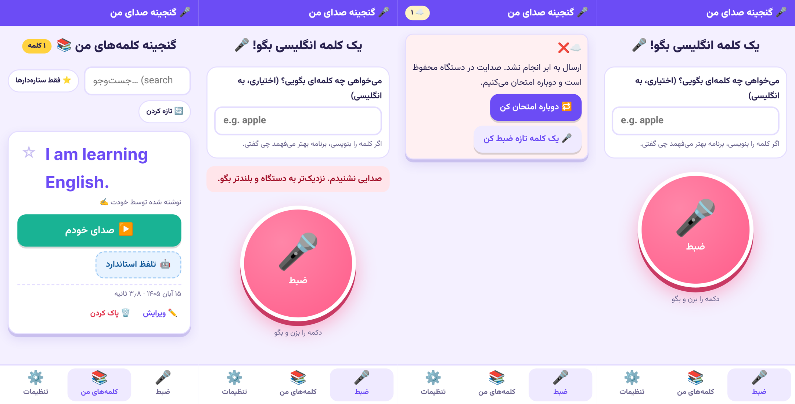

# گنجینه صدای من — EchoWords Cloud

This app helps a 9-year-old learn English. The child records English words with their own voice and the app writes down what they said, **in English only**. Every recording is kept in a private cloud library and can be replayed any number of times.

- **Interface:** Persian, right-to-left, designed for a child (big buttons, emoji, simple wording).
- **Learning content:** English only. Speech is transcribed only as English (automatic, American 🇺🇸 or British 🇬🇧). There is no translation and no other language.
- **Original audio:** "صدای خودم" (My recording) always plays the child's exact original file. "تلفظ استاندارد" (Standard pronunciation) is a separate, clearly labelled machine voice.




## How it works

```
Browser (React + TS)                         Supabase
────────────────────                         ────────
getUserMedia + MediaRecorder  ──► save to IndexedDB outbox (on-device safety net)
                              ──► upload original bytes ──► Storage bucket "recordings" (private)
                              ◄── download again + compare SHA-256 (proves it is byte-identical)
                              ──► insert row ────────────► Postgres table "words" (RLS)
                              ──► invoke "transcribe" ───► Edge Function ──► Deepgram (English only)
                                                              writes the result to the row
```

| Requirement | Where it is handled |
|---|---|
| Real microphone; timer; live level meter; pause/resume; cancel; preview; re-record | `src/lib/useRecorder.ts` |
| Permission denied, no microphone, microphone in use, http (not https), unsupported browser | `micErrorMessage()` in `useRecorder.ts` |
| Silent, too short, empty or corrupt recordings are rejected | `finalize()` in `useRecorder.ts` |
| App goes to background or microphone is unplugged: recording stops and what was captured is kept | `visibilitychange`, `pagehide` and `track.onended` handlers |
| Microphone released after stop, cancel, or leaving the screen; only one session at a time | `releaseHardware()` and the unmount cleanup |
| Uploads that are interrupted (no internet, tab closed) are recovered | `src/lib/outbox.ts` and `useLibrary.retryPending()` |
| Original can never be overwritten | Storage has no UPDATE policy; a database trigger blocks changes to the audio columns |
| Each account sees only its own data | RLS on `words` and `storage.objects` (`supabase/migrations/…_init.sql`) |
| English only; no invented transcriptions | `supabase/functions/_shared/stt.ts` → `analyzeResult()` |
| Manual correction never changes the audio | `setTranscript()`; the machine result stays in `stt_transcript` |

### When the app is not sure

The app does **not** guess. In these cases the word is marked "مطمئن نیستم" (I'm not sure) and no text is saved automatically:

- the provider returns nothing, or no Latin letters;
- the text contains non-Latin letters (for example Persian);
- the provider's own confidence is below 0.6;
- Whisper reports a high no-speech probability or a low log-probability.

The child can then:

- accept what the machine heard ("آره، درسته" / Yes, that's right);
- type the word themselves (English letters only);
- record again.

Confidence percentages are shown only when the provider actually returns one (Deepgram does; Whisper does not).

## Setup

### 1. Supabase project
1. Create a project at supabase.com.
2. Install the Supabase CLI, then run:
   ```bash
   cd echowords
   npx supabase link --project-ref <your-project-ref>
   npx supabase db push                     # creates the table, policies and private bucket
   ```
3. Under Authentication → Providers, keep Email enabled. A parent creates the child's account.

### 2. Speech-to-text (server-side secret only)
Deepgram is recommended: it supports en-US/en-GB, accepts a vocabulary hint, and returns a real confidence score.
```bash
npx supabase secrets set DEEPGRAM_API_KEY=...        # never put this in .env or the browser
npx supabase functions deploy transcribe
```
Optional settings:

- `DEEPGRAM_MODEL` (default `nova-3`)
- `DEEPGRAM_API_BASE` (for example `https://api.eu.deepgram.com`)
- To use OpenAI instead: `STT_PROVIDER=openai` and `OPENAI_API_KEY=...`. This uses `whisper-1` with `language=en`. Caution: forced-English Whisper sometimes *translates* non-English speech instead of rejecting it, which is why Deepgram is the default.

### 3. Web app
```bash
cp .env.example .env      # set VITE_SUPABASE_URL and VITE_SUPABASE_ANON_KEY (public values)
npm install
npm run dev               # development
npm run build             # production files in dist/ → any static HTTPS host
```
The microphone only works on **HTTPS** (or `localhost`). After deploying, open the address in Chrome on the Android tablet and use "Add to Home screen" to install it like an app.

## Tests

```bash
npm test          # unit tests: STT decision logic, English validation, MIME/sha256, IndexedDB outbox
npm run typecheck
```

### End-to-end test (local Supabase in Docker)
```bash
npx supabase start
python3 -m venv .venv && .venv/bin/pip install pocketsphinx
.venv/bin/python e2e/fake-deepgram.py 8787 &          # offline English recognizer, test only
printf 'DEEPGRAM_API_KEY=test\nDEEPGRAM_API_BASE=http://host.docker.internal:8787\n' > supabase/functions/.env
npx supabase functions serve --env-file supabase/functions/.env &
npm run dev &
SB_ANON=... SB_SERVICE=... SPEECH_WAV=speech.wav SILENT_WAV=silent.wav npm run e2e
```
Chromium records from a WAV file through its fake microphone device, using the same `getUserMedia` → `MediaRecorder` code a phone uses. The 24 checks cover:

- sign up and persistent login after a browser restart;
- real timer and level meter;
- microphone release;
- cloud copy byte-identical to the recording (SHA-256);
- server transcription;
- replaying the original 3 times;
- Persian rejected in the editor;
- correction leaves the audio untouched;
- silent recording rejected;
- offline save followed by automatic upload;
- privacy and overwrite protection (another user cannot read, download or overwrite; even the owner cannot overwrite);
- delete removes both the file and the row.

`e2e/fake-deepgram.py` is a **test stand-in** for Deepgram that uses the much weaker PocketSphinx recognizer. It proves the plumbing works. Real recognition quality comes from Deepgram in production.
