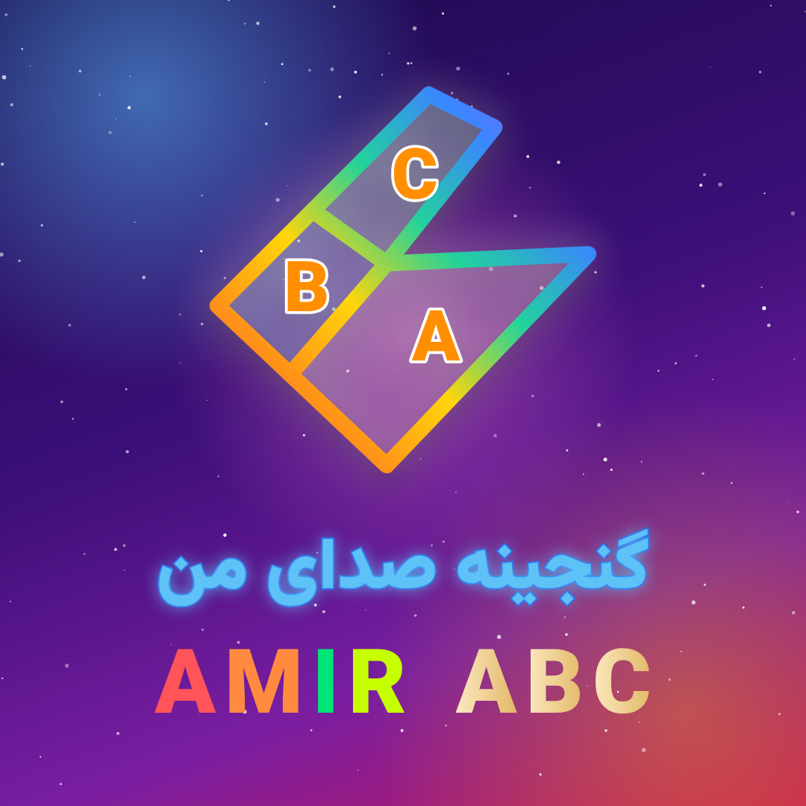

# گنجینه صدای من — EchoWords

This app helps a 9-year-old learn English. The child records English words with their own voice, sees what they said written **in English**, and replays their recordings any time.

**Nothing to set up.** There is no account, no cloud, and no server. Everything is saved on the device itself.



## Use it

Open `release/echowords.html` in Chrome. It is the whole app in one file. On an Android tablet, open the file from the Downloads folder with Chrome; if Chrome will not open it, put it on any website address instead.

- **First transcription:** the browser downloads the English speech model once (about 40 MB, needs internet). After that, transcription works offline.
- **No internet the first time:** the recording is still saved. The child presses «دوباره بنویس» (Write again) later.
- **Backup:** Settings → «ساختن فایل پشتیبان» (Make backup file) saves one file with every word and recording. «برگرداندن از فایل پشتیبان» (Restore from backup) brings them back, on the same or another device.
  > Clearing the browser's data deletes the words. Make a backup now and then.

## What it does

- **Interface:** Persian, right-to-left, kid-friendly (big buttons, emoji, simple wording).
- **English only.** Speech is transcribed with Whisper `tiny.en`, an English-only model, running inside the browser. There is no translation. Text in other scripts is rejected.
- **Real microphone recording:**
  - live timer and level meter, pause/resume, cancel, preview and re-record;
  - silent, too-short or broken recordings are rejected;
  - the microphone is always released afterwards.
- **Original voice preserved:**
  - the exact recorded bytes are stored, with a SHA-256 fingerprint;
  - the fingerprint is checked after saving, on playback, and when restoring a backup;
  - «تلفظ استاندارد» (Standard pronunciation) is a separate, clearly labelled machine voice.
- **Confirm before saving.** After recording, the text box and the «✅ تایید و ذخیره» (Confirm and save) button appear immediately. Recognition fills the box in the background, but the child never has to wait for it. If the model download stalls (no progress for 20 s), the app stops waiting and says so. Nothing is saved until confirm is pressed. After saving, a button opens «کلمه‌ها و جمله‌هایم» (My words and sentences).
- **No guessing.** If nothing English was heard, or the result differs from the word the child typed as a hint, the app asks «مطمئن نیستم چی گفتی 🤔» (I'm not sure what you said). The child can then:
  - accept what was heard,
  - use the word they typed,
  - type the word themselves (English letters only),
  - record again.

## Code

| | |
|---|---|
| `src/lib/useRecorder.ts` | getUserMedia + MediaRecorder; error, background and unmount handling |
| `src/lib/db.ts` | IndexedDB library; audio and details are written in one transaction; audio fields can never be updated |
| `src/lib/asr.ts` | On-device Whisper through transformers.js; decodes a temporary 16 kHz copy |
| `src/lib/stt.ts` | Decides when a result can be trusted |
| `src/lib/backup.ts` | Backup and restore, with fingerprint checks |

```bash
npm install
npm run dev             # development server
npm test                # unit tests
npm run build:single    # → release/echowords.html
```

`e2e/run.cjs` drives Chromium's fake microphone against the built file and checks recording, transcription, the hint mismatch, silence rejection, persistence after restart, replay, editing, backup/restore and the offline first run. The test machine cannot reach Hugging Face, so it serves the library and a Whisper model locally (see the comment at the top of the file).
